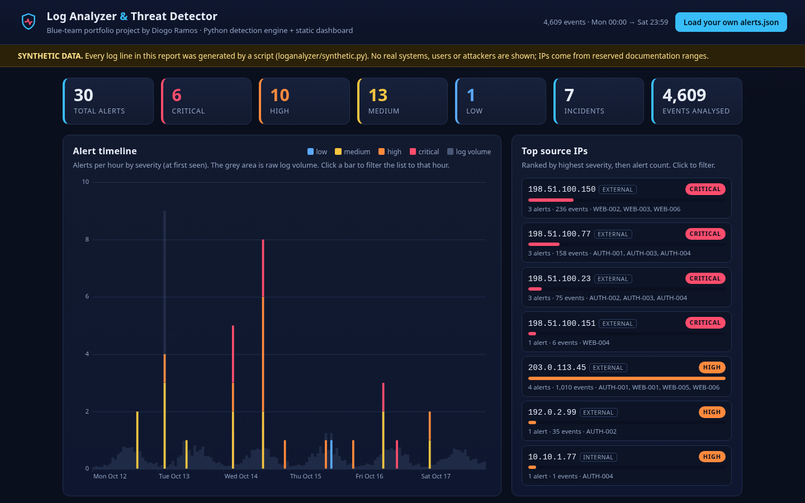
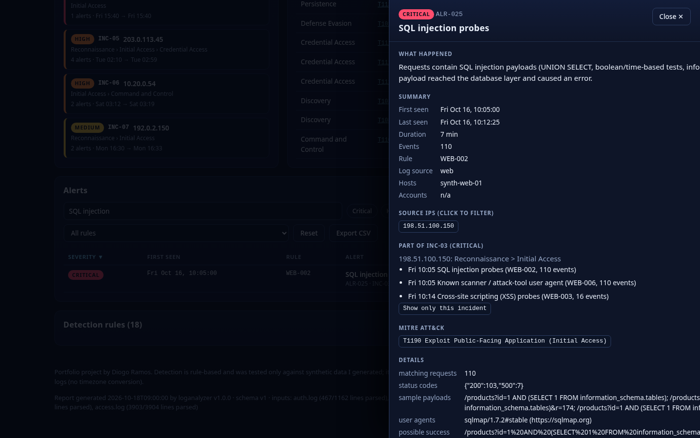
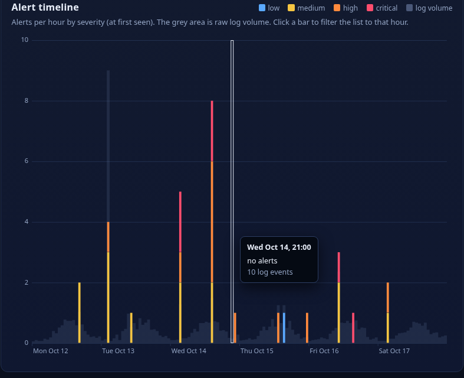
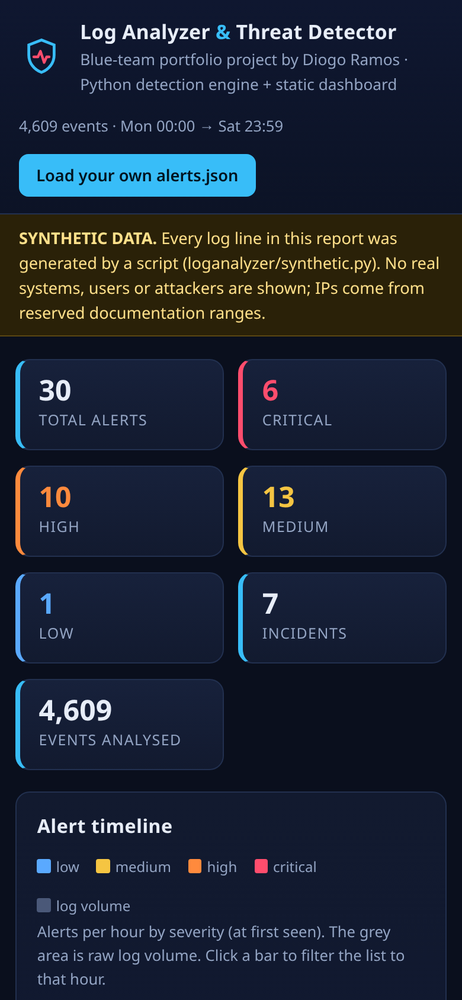

# Log Analyzer & Threat Detector

A dependency-free **Python 3** tool that reads three kinds of security logs, runs rule-based detections mapped to **MITRE ATT&CK**, and produces **JSON and Markdown incident reports**, plus a static **security-ops dashboard** (dark theme, no build step) that visualises the results.

- **Linux `auth.log`** (SSH): failed/accepted logins, `useradd`, `usermod`, `sudo`
- **Windows Security event exports** (CSV or JSON): 4624, 4625, 4672, 4688, 4720 (and 4732 for group changes)
- **nginx / Apache combined access logs**: status codes, request paths, user agents

> **All sample data is synthetic.** The logs in `data/synthetic/` are produced by `loganalyzer/synthetic.py` with a fixed random seed. Hosts, users and attackers are fictional, every file is labelled `SYNTHETIC DATA`, and all public-looking IP addresses come from the reserved documentation ranges (RFC 5737: `192.0.2.0/24`, `198.51.100.0/24`, `203.0.113.0/24`). The tool has **never been run against real production logs**, and the figures below describe this synthetic data set only.

**Live demo (synthetic data):** https://log-analyzer-threat-detector.vercel.app

## The problem

Help desk and junior security analysts get asked "is this normal?" all the time: a burst of failed SSH logins at 2 a.m., a new local administrator nobody remembers creating, a web server full of 404s. The raw logs have the answer, but each source has its own format, and nobody wants to `grep` three machines at once. I wanted to understand what a SIEM actually does under the hood: parse differently-shaped logs into one model, apply readable detection rules, explain *why* something fired, and tell the person on call what to do next.

## What it does

- **Parses** three formats into one normalised `Event` model, and reports how many lines were parsed, ignored or malformed per file (so silent parse failures are visible).
- **Detects** 18 patterns (table below), defined in a readable JSON rule file with thresholds, severities, ATT&CK mappings and recommended responses. Change a threshold without touching code.
- **Correlates** alerts into incidents: alerts sharing a source IP are one story, and IP-less alerts (account creation, process execution) join the incident on the same host within 30 minutes.
- **Reports** per alert: severity, first/last seen, event count, source IPs, accounts, hosts, ATT&CK techniques, a sampled timeline, raw evidence lines, and numbered response steps.
- **Evaluates itself** against a ground-truth file listing every injected attack, so "did each rule fire on the attack it was written for, and did benign noise stay quiet?" is a command, not a feeling.
- **Dashboard**: severity summary, canvas timeline, top source IPs, incident list, ATT&CK table, filterable alert list, drill-down drawer (timeline, evidence, response, "copy as ticket note"), CSV export, and "load your own `alerts.json`" (processed in the browser; nothing is uploaded).

## Screenshots

Real screenshots of the dashboard in headless Chrome, taken by `scripts/dashboard_smoke.js` (which also asserts that the page behaves).

**Overview: severity summary, timeline and top source IPs**


**Drill-down on a critical alert (SQL injection probes with HTTP 500 responses)**


**Timeline hover (hourly bins, log volume in grey)**


**On a phone-sized screen**


## Architecture


## How to run it

Requires Python 3.10+ and nothing else to run the tool (pytest is only needed for the tests). Tested on Python 3.13.

```bash
git clone <your-repo-url>
cd log-analyzer

python -m venv .venv
# Windows (PowerShell):  .venv\Scripts\Activate.ps1     Linux/macOS:  source .venv/bin/activate
pip install -r requirements-dev.txt        # pytest + pytest-cov (tests only)

python -m loganalyzer demo                 # generate synthetic logs, analyze, write reports, self-check
python -m pytest                           # 157 tests
python -m http.server 8000 --directory dashboard    # open http://localhost:8000
```

Analyze your own logs:

```bash
python -m loganalyzer analyze \
    --auth /var/log/auth.log --year 2026 \
    --windows security_export.csv \
    --web /var/log/nginx/access.log --web-host web-01 \
    --out-json alerts.json --out-md incident_report.md
# then open the dashboard and use "Load your own alerts.json"
```

| Command | Purpose |
|---|---|
| `analyze` | parse logs, run rules, print a summary, write `--out-json` / `--out-md` |
| `list-rules` / `validate-rules` | show the rules / check a rule file (non-zero exit if broken) |
| `generate` | write the synthetic logs and `ground_truth.json` (`--seed N` for a different set) |
| `demo` | generate, analyze, write `reports/` and `dashboard/data/alerts.json`, then evaluate against ground truth |

Useful `analyze` options: `--min-severity high`, `--ignore-ip <your scanner>` (repeatable), `--fail-on critical` (exit status 2 if any alert is at or above that severity, handy for cron/CI), `--synthetic` (label the report), `--no-colour`. Exit codes: `0` ok, `2` `--fail-on` tripped, `3` usage/input error.

If you edit a rule, `python -m loganalyzer validate-rules` catches typos in rule types, severities, thresholds, regexes and ATT&CK IDs before you run anything.

## Detection rules

All 18 live in [`rules/detection_rules.json`](rules/detection_rules.json). Thresholds below are the defaults I chose; they are tuning knobs, not industry standards.

| ID | Detects | Sources | Severity | ATT&CK | Default trigger |
|---|---|---|---|---|---|
| `AUTH-001` | Brute-force logins from one IP | auth, windows | high | T1110.001 | ≥10 failures in 5 min, >3 tries per account |
| `AUTH-002` | Password spraying (many accounts, few tries) | auth, windows | high | T1110.003 | ≥8 accounts within 30 min, ≤3 tries each |
| `AUTH-003` | Successful login after many failures | auth, windows | critical | T1110, T1078 | ≥8 failures in 30 min, then success from same IP |
| `ACCT-001` | New local account created (4720 / `useradd`) | auth, windows | medium | T1136.001 | any occurrence |
| `ACCT-002` | New account given admin rights (4732 / 4672 / `sudo` group) | auth, windows | critical | T1136.001, T1098 | within 60 min of creation |
| `AUTH-004` | Successful login outside business hours | auth, windows | medium → high if 4672 | T1078 | outside 07:00-19:00 Mon-Fri |
| `WEB-001` | HTTP 404 flood (directory scanning) | web | medium | T1595.003, T1595.002 | ≥40 × 404 in 2 min from one IP |
| `WEB-002` | SQL injection probes | web | high → critical on HTTP 500 | T1190 | ≥2 matching requests |
| `WEB-003` | XSS probes | web | medium | T1190 | ≥2 matching requests |
| `WEB-004` | Path traversal / LFI | web | high → critical on HTTP 200 | T1190 | ≥2 matching requests |
| `WEB-005` | Probing for `.env`, `.git`, phpMyAdmin, etc. | web | medium | T1595.003, T1190 | ≥3 distinct sensitive paths |
| `WEB-006` | Known scanner user agent (sqlmap, nikto, gobuster, ...) | web | medium | T1595.002 | ≥1 request |
| `WEB-007` | Scripted / empty user agent, high volume | web | low | T1595 | ≥20 requests |
| `WIN-001` | Encoded PowerShell (4688) | windows | high | T1059.001, T1027 | ≥1 |
| `WIN-002` | `certutil` / `bitsadmin` / web-cmdlet download (4688) | windows | high | T1105 | ≥1 |
| `WIN-003` | Account added with `net user /add` (4688) | windows | high | T1136.001, T1098 | ≥1 |
| `WIN-004` | Burst of recon commands (`whoami /all`, `nltest`, `net group`) | windows | medium | T1033, T1087 | ≥2 by same user/host within 1 h |
| `WIN-005` | Shadow-copy deletion / recovery disabled | windows | critical | T1490 | ≥1 |

Brute force and spraying are separated on purpose: they look the same if you only count failures, so `AUTH-001` requires several tries per account and `AUTH-002` requires many accounts with few tries each. Web payload patterns are checked after URL-decoding twice, so `%252e%252e%252f` is still caught.

## The synthetic data set

`python -m loganalyzer demo` writes about 4,600 events over a fictional Monday-Saturday week (Oct 12-17, 2026): `auth.log`, a Windows Security CSV (domain controller), a Windows Security JSON (workstation) and an nginx-style `access.log`. Background traffic is deliberately noisy: business-hours logins and typos, a monitoring service that logs in all night, Googlebot hitting 404s, an admin running `ipconfig /all`, and a ticketed `adduser`. Eleven attacks are injected on top:

| Injected scenario | What it exercises |
|---|---|
| SSH dictionary brute force (276 attempts, never succeeds) | `AUTH-001` |
| Brute force that succeeds at 03:41, then a new sudo-capable user `sysupdate` | `AUTH-001/003/004`, `ACCT-001/002` |
| SSH password spray (24 usernames, 1-2 tries each) | `AUTH-002` |
| Windows spray (34 accounts) → `svc_backup` falls → encoded PowerShell, recon, `certutil` download, `net user /add`, new admin `helpdesk_tmp`, RDP at 22:15 | `AUTH-002/003/004`, `WIN-001..004`, `ACCT-001/002` |
| Admin logs on at 23:40 with special privileges | `AUTH-004` (high) |
| Saturday 03:12 VPN login, then `certutil` download | `AUTH-004`, `WIN-002` |
| `gobuster` directory scan from the same IP that brute-forced SSH | `WEB-001/005/006` (cross-source incident) |
| `sqlmap` (some HTTP 500) then reflected-XSS probes | `WEB-002/003/006` |
| Path traversal, first attempt returns HTTP 200 | `WEB-004` (critical) |
| Nikto scan | `WEB-005/006` |
| `python-requests` scraper (45 requests) | `WEB-007` (low) |

`ground_truth.json` lists the alerts each scenario *should* produce. The encoded PowerShell payload decodes to a harmless `Write-Output` line; no malicious content is included.

## Sample output

Console (`python -m loganalyzer demo`):

```text
Analysed 4,609 events (auth=467, web=3903, windows=239) | 30 alerts | 7 incidents
Severity: CRITICAL 6  HIGH 10  MEDIUM 13  LOW 1

Incidents:
  INC-01 [CRITICAL] 198.51.100.77: Initial Access > Persistence > Credential Access
  INC-02 [CRITICAL] 198.51.100.23: Initial Access > Execution > Persistence > Defense Evasion > Credential Access > Discovery > Command and Control
  INC-03 [CRITICAL] 198.51.100.150: Reconnaissance > Initial Access
  INC-04 [CRITICAL] 198.51.100.151: Initial Access
  INC-05 [  HIGH  ] 203.0.113.45: Reconnaissance > Initial Access > Credential Access
  ...
Alerts:
  ALR-008 [CRITICAL] AUTH-003 2026-10-14 03:20:10 Successful login after many failures  ips=198.51.100.77 n=79
  ALR-011 [CRITICAL] ACCT-002 2026-10-14 03:43:41 New account 'sysupdate' was given administrative rights  ips=- n=2
  ...

Evaluation against injected ground truth (synthetic data only)
  scenarios fully detected : 12/12
  expected alerts detected : 30/30
  unexpected alerts        : 0
```

Analysis of the whole synthetic set takes about 0.2 s on the machine I built it on (single-threaded, standard library only).

Markdown report excerpt (`reports/incident_report.md`):

````markdown
### ALR-011 [CRITICAL] New account 'sysupdate' was given administrative rights

- **Rule:** ACCT-002  |  **Incident:** INC-01
- **When:** 2026-10-14T03:43:41 to 2026-10-14T03:44:06 (2 events)
- **Source IPs:** n/a  |  **Accounts:** sysupdate  |  **Hosts:** synth-web-01
- **MITRE ATT&CK:** T1136.001 Create Account: Local Account, T1098 Account Manipulation
- **Details:** new_account=sysupdate; created_by=deploy; privilege_via=['sudo']; minutes_to_privilege=0.4

Timeline:
- `2026-10-14T03:43:41` account created: sysupdate (by deploy)
- `2026-10-14T03:44:06` sysupdate added to group sudo

Recommended response:
1. Disable the new account and remove it from privileged groups right away.
2. Identify the session that created it (creator account, source IP, time) and treat that account as compromised.
...
````

JSON report: `reports/alerts.json` (what the dashboard loads) has `meta`, `summary` (severity counts, top IPs, ATT&CK table, hourly volume), `incidents`, `alerts` (each with `timeline`, `evidence`, `recommended_response`, `details`) and `rules`.

## Project layout

```
loganalyzer/
  parsers/           auth_log.py, windows.py, web_access.py -> Event objects + ParseStats
  models.py          normalised Event, constants
  rules.py           rule-file loader and validator
  detectors.py       one function per rule type + sliding-window helpers
  alerts.py          Alert / Incident objects, timeline sampling
  engine.py          run rules, correlate incidents, top IPs, ATT&CK summary
  report.py          JSON + Markdown writers
  evaluate.py        compare alerts with synthetic ground truth
  synthetic.py       seeded synthetic data generator
  cli.py             argparse CLI
rules/detection_rules.json
data/synthetic/      generated logs + ground_truth.json (labelled SYNTHETIC)
reports/             sample alerts.json, incident_report.md, evaluation.json
dashboard/           static site: index.html, app.js, style.css, data/alerts.json, vercel.json
tests/               pytest suite
scripts/dashboard_smoke.js   optional headless-Chrome check + screenshots (needs playwright-core)
```

## Tests

```bash
python -m pytest                                        # all tests
python -m pytest --cov=loganalyzer --cov-report=term-missing
```

157 tests; line coverage of the `loganalyzer` package measured at 99% (`pytest-cov`). Coverage shows the code was executed, not that every behaviour is right, so the tests are written around behaviours: each detector has a fires / does-not-fire / boundary case (for example exactly 10 vs 9 failures, 07:00 vs 19:00), parsers get malformed and unusual input, the rule validator rejects each kind of broken rule, report schemas are checked, the CLI is exercised end to end (including exit codes), the synthetic generator is checked for determinism and labelling, and the dashboard folder is checked statically (no inline scripts, no `innerHTML`, CSP present). A separate browser script, `scripts/dashboard_smoke.js`, drives the real dashboard in headless Chrome (filters, drill-down, hostile `<script>` text in an uploaded file stays inert).

## Design notes and limitations

**What this is not.** It is a learning project, not a SIEM or an EDR. Please read the numbers above with these caveats:

- **Self-graded.** The detections, the thresholds and the attacks in the synthetic data were all written by me, so "12/12 scenarios, 0 unexpected alerts" shows the rules do what I wrote them to do on data I designed. It is **not** a detection rate or false-positive rate for real environments, and I have no data on how it would behave on real logs.
- **Rule-based and evadable.** Thresholds and regexes miss low-and-slow attacks (a few attempts per hour), distributed attacks spread over many IPs, payloads obfuscated beyond double URL-decoding, and spoofed user agents. An absent alert is not proof of safety.
- **Timestamps are wall-clock.** Each log's time is used as written; there is no timezone normalisation between sources. `auth.log` has no year, so you pass `--year` (the parser handles a December-to-January rollover). Off-hours logic uses fixed business hours, not a per-user baseline.
- **Windows coverage is narrow.** Only 4624/4625/4672/4688/4720/4732. `4688` needs process-command-line auditing enabled to be useful. No Kerberos events, lockouts (4740), logoff, or SID-level matching: `ACCT-002` matches the new account by name.
- **Correlation is a heuristic.** Same IP, or same host within 30 minutes, can merge unrelated activity behind shared NAT addresses or split one attacker who changes IPs. Internal vs external is a simple RFC 1918 check; there is no geolocation or threat-intelligence lookup.
- **Not built for scale.** It reads whole files into memory and some rules are quadratic in the number of events per IP. I have only run it on about 4,600 events.
- **No state.** Each run is independent: no alert suppression across runs, no baselines, no ticket integration, and no automated response (it only recommends).
- **Dashboard is a static snapshot** with no login. The hosted copy contains only the synthetic `alerts.json`. Uploaded files are parsed in your browser; log lines are inserted as text (never HTML) because logs contain attacker-controlled strings, and the Vercel config sets a strict Content-Security-Policy.

## Deploying the dashboard

`dashboard/` is a self-contained static site (no build step). On Vercel, either import the repository (the root `vercel.json` sets `outputDirectory` to `dashboard`) or deploy the `dashboard/` folder directly. Any static host works. Opening `index.html` straight from disk won't load the data because browsers block `fetch()` on `file://`; serve it with `python -m http.server` or use the "Load your own alerts.json" button.

## What I learned

- **Counting failures is not enough.** Brute force and password spraying need different shapes of rule (many tries on few accounts vs few tries on many). My first spray rule also fired on the first minute of a loud brute force, because early on that looked like "one or two tries per account". The fix was to judge the whole attack episode instead of the ramp-up. Tests that reproduce a mistake like this are worth more than tests that confirm the happy path.
- **Bursts of events must become one alert.** Overlapping sliding windows are merged into episodes, otherwise one 40-minute attack becomes dozens of duplicate alerts; that is the difference between a tool and noise.
- **Logs are messy.** Syslog timestamps have no year, `sshd` logs both an "Invalid user" line and a "Failed password" line for the same attempt (count once), Windows exports name their columns differently depending on the tool, and web payloads arrive URL-encoded, sometimes twice.
- **Writing for the person on call.** An alert needs the evidence, a timeline and the next action, and the recommended steps (preserve logs, verify with the user, do not delete the evidence) matter as much as the detection. That is the same habit as writing good ticket notes.
- **Mapping to ATT&CK is a discipline.** Choosing a technique ID forces you to say precisely what you actually observed, and the coverage table makes it obvious what the rules do not cover.
- **The dashboard is an attack surface too.** The evidence panel displays strings an attacker chose (`<script>`, SQL). Using `textContent`, a strict CSP and a test that loads a hostile title is cheap, and it is the sort of thing a security tool should get right.

## Tech

Python 3 (standard library: `argparse`, `re`, `csv`, `json`, `ipaddress`, `dataclasses`), pytest, pytest-cov, HTML/CSS/vanilla JavaScript (canvas, no dependencies), Mermaid (README diagram), Playwright-core (optional screenshots), Git, Vercel (static hosting). Topics: SSH and Windows authentication logs, MITRE ATT&CK, log parsing, detection engineering, incident reporting.

## Licence

MIT, see [LICENSE](LICENSE).
