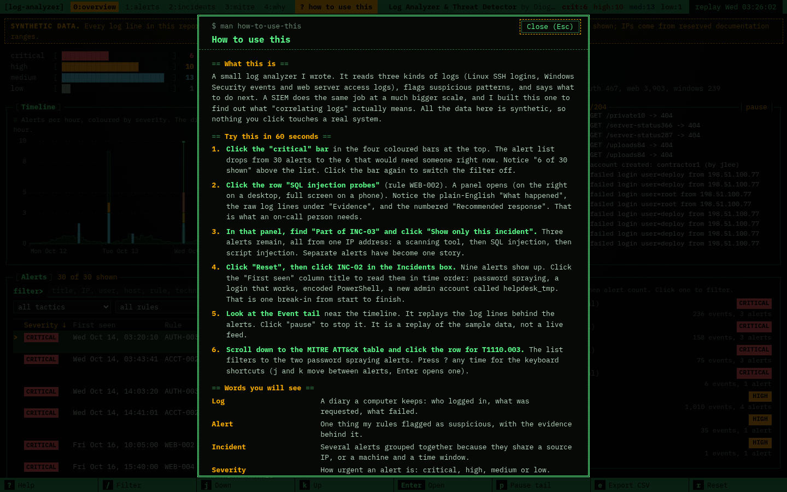
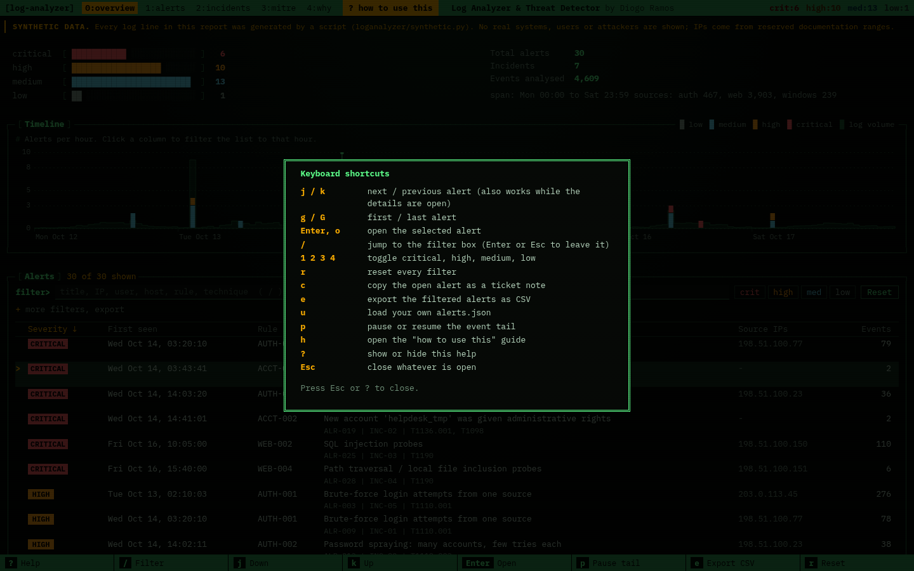
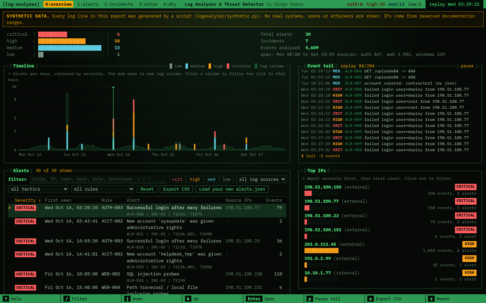
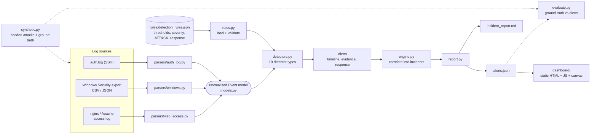

# Log Analyzer & Threat Detector

I'm Diogo, a CS student in Toronto, and I'm teaching myself forensics and security. This is a Python tool that reads three kinds of logs, runs detection rules against them, maps what it finds to MITRE ATT&CK and writes incident reports in JSON and Markdown. There's also a dashboard that looks like a terminal ops console (more on that below). Python 3 and the standard library are all you need to run the analyzer.

- **Linux `auth.log`** (SSH): failed and accepted logins, `useradd`, `usermod`, `sudo`
- **Windows Security event exports** (CSV or JSON): 4624, 4625, 4672, 4688, 4720, plus 4732 for group changes
- **nginx / Apache combined access logs**: status codes, paths, user agents

> **Everything in the sample data is synthetic.** The logs in `data/synthetic/` come from `loganalyzer/synthetic.py` with a fixed random seed. Hosts, users and attackers are made up, every file is labelled `SYNTHETIC DATA`, and all the public-looking IP addresses are from the reserved documentation ranges (RFC 5737: `192.0.2.0/24`, `198.51.100.0/24`, `203.0.113.0/24`). I have never run this on real production logs, and every number below is about the synthetic set only.

**Live demo (synthetic data):** https://log-analyzer-threat-detector.vercel.app

## How to use the demo

The live site has a **"how to use this"** button in the top bar (or press `h`) and a small "Start here" box the first time you visit. Both open the same guide. If you only have a minute:

1. Click the **critical** bar in the four coloured bars at the top. The list drops from 30 alerts to the 6 that need someone right now. Click the bar again to clear it.
2. Click the row **SQL injection probes** (`WEB-002`). A panel opens with a plain-English "What happened", the raw log lines under "Evidence" and numbered "Recommended response" steps.
3. In that panel, find **Part of INC-03** and click **Show only this incident**. Three alerts from one IP, in order: a scanning tool, SQL injection, then script injection. Separate alerts have become one story.
4. Click **Reset**, then click **INC-02** in the Incidents box. Click the "First seen" column title to read the nine alerts in time order: password spraying, a login that works, encoded PowerShell, a new admin account called `helpdesk_tmp`.
5. Watch the **Event tail** and click **pause**. It is a replay of the sample data, not a live feed.
6. Scroll to the MITRE ATT&CK table and click the **T1110.003** row to see just the password spraying alerts. Press `?` for the keyboard shortcuts.

The guide also has a short glossary (brute force, password spraying, SQL injection, MITRE ATT&CK and so on) and a note on what the project says about my skills. A browser test in `scripts/dashboard_smoke.js` follows these exact steps, so the guide and the page can't drift apart.



## Why I built it

Help desk and junior security people get asked "is this normal?" all the time. A burst of failed SSH logins at 2 a.m., a new local admin nobody remembers creating, a web server full of 404s. The answer is in the logs, but every source has its own format and nobody wants to `grep` three machines at once. I kept reading that a SIEM "correlates logs" without really knowing what that meant, so I built a small one to find out. I wanted to parse differently shaped logs into one model, write readable rules, explain why something fired, and say what to do next.

The dashboard has a longer "Why I built this" note in my own words, including the thing that surprised me most (brute force and password spraying look the same until you try to write the rules).

## What it does

- **Parses** three formats into one `Event` model, and tells you how many lines were parsed, ignored or malformed per file, so a silent parse failure can't hide.
- **Detects** 18 patterns (table below). They live in a JSON rule file with thresholds, severities, ATT&CK mappings and recommended responses, so you can change a threshold without touching code.
- **Groups alerts into incidents.** Alerts from the same source IP are one story. Alerts with no IP (an account being created, a process running) join the incident on the same host within 30 minutes.
- **Explains each alert** with severity, first and last seen, event count, source IPs, accounts, hosts, ATT&CK techniques, a sampled timeline, the raw evidence lines and numbered response steps.
- **Checks itself** against a ground-truth file that lists every attack I injected, so "did each rule fire on the attack it was written for, and did the noise stay quiet?" is a command and not a feeling.

## The dashboard

The dashboard is a static page with no build step. I wanted it to feel like something you'd leave open in a terminal pane, so it's dark, monospace, phosphor green and amber on near-black, with a tmux-style status bar on top, an htop-style severity meter, a key bar along the bottom, and panels drawn with real box-drawing characters.

What's on it: severity summary, a timeline (canvas), top source IPs, correlated incidents, the MITRE ATT&CK table, a filterable alert list, a drill-down pane (timeline, evidence, response steps, "Copy as ticket note"), CSV export, and "Load your own alerts.json". Next to the timeline there's an **event tail**: a replay of the events behind the alerts, scrolling by on its own. It is a replay of the synthetic data, not a live feed. A green line on the timeline shows where the tail is.

Keyboard shortcuts (press `?` on the page for the same list):

| Key | What it does |
|---|---|
| `j` / `k` | next / previous alert (also works while the details are open) |
| `g` / `G` | first / last alert |
| `Enter` or `o` | open the selected alert |
| `/` | jump to the filter box (`Enter` or `Esc` to leave it) |
| `1` `2` `3` `4` | toggle critical, high, medium, low |
| `r` | reset all filters |
| `c` | copy the open alert as a ticket note |
| `e` | export the filtered alerts as CSV |
| `u` | load your own `alerts.json` |
| `p` | pause or resume the event tail |
| `h` | open the "how to use this" guide |
| `?` / `Esc` | help / close whatever is open |

A few details: uploaded files are read in your browser and never sent anywhere. Log lines are always inserted as text, never as HTML, because logs contain strings an attacker chose. The Content-Security-Policy is strict (`default-src 'self'`, no inline script or style). The one font (a subset of IBM Plex Mono, licence in `dashboard/fonts/`) is served from the same site, so no third party is contacted.

## Screenshots

These are real screenshots from headless Chrome, taken by `scripts/dashboard_smoke.js`, which also checks that the page behaves.

**Overview: severity meters, timeline, event tail, alert list**


**Drill-down on a critical alert (SQL injection probes that got HTTP 500s)**


**Timeline hover (hourly columns, log volume in dim green)**


**Keyboard help (`?`)**


**On a phone-sized screen**


**The deployed site**


## Architecture



## Running it

You need Python 3.10 or newer. I tested on 3.13. pytest is only needed for the tests.

```bash
git clone https://github.com/SomarGuy/log-analyzer-threat-detector.git
cd log-analyzer-threat-detector

python -m venv .venv
# Windows (PowerShell):  .venv\Scripts\Activate.ps1     Linux/macOS:  source .venv/bin/activate
pip install -r requirements-dev.txt        # pytest + pytest-cov, tests only

python -m loganalyzer demo                 # make synthetic logs, analyze, write reports, self-check
python -m pytest                           # 167 tests
python -m http.server 8000 --directory dashboard    # open http://localhost:8000
```

To analyze your own logs:

```bash
python -m loganalyzer analyze \
    --auth /var/log/auth.log --year 2026 \
    --windows security_export.csv \
    --web /var/log/nginx/access.log --web-host web-01 \
    --out-json alerts.json --out-md incident_report.md
# then open the dashboard and use "Load your own alerts.json"
```

| Command | What it does |
|---|---|
| `analyze` | parse logs, run rules, print a summary, write `--out-json` / `--out-md` |
| `list-rules` / `validate-rules` | show the rules / check a rule file (non-zero exit if it's broken) |
| `generate` | write the synthetic logs and `ground_truth.json` (`--seed N` for a different set) |
| `demo` | generate, analyze, write `reports/` and `dashboard/data/alerts.json`, then check against ground truth |

Handy `analyze` options: `--min-severity high`, `--ignore-ip <your scanner>` (repeatable), `--fail-on critical` (exit status 2 if any alert is at or above that severity, good for cron), `--synthetic` (label the report), `--no-colour`. Exit codes: `0` fine, `2` `--fail-on` tripped, `3` bad usage or input.

If you edit a rule, `python -m loganalyzer validate-rules` catches typos in rule types, severities, thresholds, regexes and ATT&CK IDs before you run anything.

## Detection rules

All 18 live in [`rules/detection_rules.json`](rules/detection_rules.json). The thresholds are the defaults I picked. They are knobs to turn, not industry standards.

| ID | Detects | Sources | Severity | ATT&CK | Default trigger |
|---|---|---|---|---|---|
| `AUTH-001` | Brute-force logins from one IP | auth, windows | high | T1110.001 | ≥10 failures in 5 min, >3 tries per account |
| `AUTH-002` | Password spraying (many accounts, few tries) | auth, windows | high | T1110.003 | ≥8 accounts within 30 min, ≤3 tries each |
| `AUTH-003` | Successful login after many failures | auth, windows | critical | T1110, T1078 | ≥8 failures in 30 min, then success from same IP |
| `ACCT-001` | New local account created (4720 / `useradd`) | auth, windows | medium | T1136.001 | any occurrence |
| `ACCT-002` | New account given admin rights (4732 / 4672 / `sudo` group) | auth, windows | critical | T1136.001, T1098 | within 60 min of creation |
| `AUTH-004` | Successful login outside business hours | auth, windows | medium → high if 4672 | T1078 | outside 07:00-19:00 Mon-Fri |
| `WEB-001` | HTTP 404 flood (directory scanning) | web | medium | T1595.003, T1595.002 | ≥40 × 404 in 2 min from one IP |
| `WEB-002` | SQL injection probes | web | high → critical on HTTP 500 | T1190 | ≥2 matching requests |
| `WEB-003` | XSS probes | web | medium | T1190 | ≥2 matching requests |
| `WEB-004` | Path traversal / LFI | web | high → critical on HTTP 200 | T1190 | ≥2 matching requests |
| `WEB-005` | Probing for `.env`, `.git`, phpMyAdmin, etc. | web | medium | T1595.003, T1190 | ≥3 distinct sensitive paths |
| `WEB-006` | Known scanner user agent (sqlmap, nikto, gobuster, ...) | web | medium | T1595.002 | ≥1 request |
| `WEB-007` | Scripted / empty user agent, high volume | web | low | T1595 | ≥20 requests |
| `WIN-001` | Encoded PowerShell (4688) | windows | high | T1059.001, T1027 | ≥1 |
| `WIN-002` | `certutil` / `bitsadmin` / web-cmdlet download (4688) | windows | high | T1105 | ≥1 |
| `WIN-003` | Account added with `net user /add` (4688) | windows | high | T1136.001, T1098 | ≥1 |
| `WIN-004` | Burst of recon commands (`whoami /all`, `nltest`, `net group`) | windows | medium | T1033, T1087 | ≥2 by same user/host within 1 h |
| `WIN-005` | Shadow-copy deletion / recovery disabled | windows | critical | T1490 | ≥1 |

I split brute force and spraying on purpose. If you only count failed logins they look identical, so `AUTH-001` wants several tries per account and `AUTH-002` wants lots of accounts with only a few tries each. Web payloads are checked after URL-decoding twice, so `%252e%252e%252f` still gets caught.


## The synthetic data

`python -m loganalyzer demo` writes about 4,600 events for a made-up Monday to Saturday week (Oct 12 to 17, 2026): an `auth.log`, a Windows Security CSV from a domain controller, a Windows Security JSON from a workstation, and an nginx-style `access.log`. The background traffic is noisy on purpose: business-hours logins with typos, a monitoring service that logs in all night, Googlebot hitting 404s, an admin running `ipconfig /all`, and an `adduser` that had a ticket. I then injected eleven attacks on top:

| Injected scenario | What it exercises |
|---|---|
| SSH dictionary brute force (276 attempts, never succeeds) | `AUTH-001` |
| Brute force that succeeds at 03:41, then a new sudo-capable user `sysupdate` | `AUTH-001/003/004`, `ACCT-001/002` |
| SSH password spray (24 usernames, 1-2 tries each) | `AUTH-002` |
| Windows spray (34 accounts) → `svc_backup` falls → encoded PowerShell, recon, `certutil` download, `net user /add`, new admin `helpdesk_tmp`, RDP at 22:15 | `AUTH-002/003/004`, `WIN-001..004`, `ACCT-001/002` |
| Admin logs on at 23:40 with special privileges | `AUTH-004` (high) |
| Saturday 03:12 VPN login, then `certutil` download | `AUTH-004`, `WIN-002` |
| `gobuster` directory scan from the same IP that brute-forced SSH | `WEB-001/005/006` (cross-source incident) |
| `sqlmap` (some HTTP 500) then reflected-XSS probes | `WEB-002/003/006` |
| Path traversal, first attempt returns HTTP 200 | `WEB-004` (critical) |
| Nikto scan | `WEB-005/006` |
| `python-requests` scraper (45 requests) | `WEB-007` (low) |

`ground_truth.json` lists the alerts each scenario *should* produce. The encoded PowerShell payload decodes to a harmless `Write-Output` line. There is nothing malicious in the repo.

## Sample output

Console (`python -m loganalyzer demo`):

```text
Analysed 4,609 events (auth=467, web=3903, windows=239) | 30 alerts | 7 incidents
Severity: CRITICAL 6  HIGH 10  MEDIUM 13  LOW 1

Incidents:
  INC-01 [CRITICAL] 198.51.100.77: Initial Access > Persistence > Credential Access
  INC-02 [CRITICAL] 198.51.100.23: Initial Access > Execution > Persistence > Defense Evasion > Credential Access > Discovery > Command and Control
  INC-03 [CRITICAL] 198.51.100.150: Reconnaissance > Initial Access
  INC-04 [CRITICAL] 198.51.100.151: Initial Access
  INC-05 [  HIGH  ] 203.0.113.45: Reconnaissance > Initial Access > Credential Access
  ...
Alerts:
  ALR-008 [CRITICAL] AUTH-003 2026-10-14 03:20:10 Successful login after many failures  ips=198.51.100.77 n=79
  ALR-011 [CRITICAL] ACCT-002 2026-10-14 03:43:41 New account 'sysupdate' was given administrative rights  ips=- n=2
  ...

Evaluation against injected ground truth (synthetic data only)
  scenarios fully detected : 12/12
  expected alerts detected : 30/30
  unexpected alerts        : 0
```

The whole synthetic set takes about 0.2 s to analyse on the machine I built it on (one thread, standard library only).

Markdown report excerpt (`reports/incident_report.md`):

````markdown
### ALR-011 [CRITICAL] New account 'sysupdate' was given administrative rights

- **Rule:** ACCT-002  |  **Incident:** INC-01
- **When:** 2026-10-14T03:43:41 to 2026-10-14T03:44:06 (2 events)
- **Source IPs:** n/a  |  **Accounts:** sysupdate  |  **Hosts:** synth-web-01
- **MITRE ATT&CK:** T1136.001 Create Account: Local Account, T1098 Account Manipulation
- **Details:** new_account=sysupdate; created_by=deploy; privilege_via=['sudo']; minutes_to_privilege=0.4

Timeline:
- `2026-10-14T03:43:41` account created: sysupdate (by deploy)
- `2026-10-14T03:44:06` sysupdate added to group sudo

Recommended response:
1. Disable the new account and remove it from privileged groups right away.
2. Identify the session that created it (creator account, source IP, time) and treat that account as compromised.
...
````

The JSON report, `reports/alerts.json`, is what the dashboard loads. It has `meta`, `summary` (severity counts, top IPs, ATT&CK table, hourly volume), `incidents`, `alerts` (each with `timeline`, `evidence`, `recommended_response` and `details`) and `rules`.


## Project layout

```
loganalyzer/
  parsers/           auth_log.py, windows.py, web_access.py -> Event objects + ParseStats
  models.py          normalised Event, constants
  rules.py           rule-file loader and validator
  detectors.py       one function per rule type + sliding-window helpers
  alerts.py          Alert / Incident objects, timeline sampling
  engine.py          run rules, correlate incidents, top IPs, ATT&CK summary
  report.py          JSON + Markdown writers
  evaluate.py        compare alerts with synthetic ground truth
  synthetic.py       seeded synthetic data generator
  cli.py             argparse CLI
rules/detection_rules.json
data/synthetic/      generated logs + ground_truth.json (labelled SYNTHETIC)
reports/             sample alerts.json, incident_report.md, evaluation.json
dashboard/           static site: index.html, app.js, style.css, fonts/, data/alerts.json, vercel.json
tests/               pytest suite
scripts/dashboard_smoke.js   headless Chrome check + screenshots (needs playwright-core)
```


## Tests

```bash
python -m pytest                                        # everything
python -m pytest --cov=loganalyzer --cov-report=term-missing
```

167 tests. Line coverage of the `loganalyzer` package was 99% when I measured it with `pytest-cov`. Coverage only shows the code ran, not that it's right, so I wrote the tests around behaviour. Each detector has a fires / doesn't fire / boundary case (exactly 10 failures vs 9, 07:00 vs 19:00). Parsers get malformed and strange input. The rule validator has to reject every kind of broken rule. Report schemas are checked, the CLI is run end to end including exit codes, and the synthetic generator is checked for determinism and labelling. The dashboard folder gets static checks too: no inline scripts, no `innerHTML`, CSP present, font files exist, no em-dashes in the copy.

`scripts/dashboard_smoke.js` drives the real dashboard in headless Chrome: the tail scrolling and pausing, j / k / g / G, Enter, `/`, `?`, number keys, every filter, the CSV download, copy as ticket note, loading a file, and a hostile `<script>` title staying inert.

## What it can't do

It's a learning project, not a SIEM or an EDR. Please read the numbers above with this in mind:

- **I graded my own homework.** I wrote the detections, the thresholds and the attacks in the data. "12/12 scenarios, 0 unexpected alerts" only shows the rules do what I wrote them to do on data I designed. It is not a detection rate or a false-positive rate for a real network, and I have no idea how it would behave on real logs.
- **It's easy to get around.** Thresholds and regexes miss slow attacks (a few tries an hour), attacks spread over many IPs, payloads hidden beyond double URL-decoding, and spoofed user agents. No alert doesn't mean you're safe.
- **Timestamps are whatever the log says.** There's no timezone conversion between sources. `auth.log` has no year, so you pass `--year` (December to January rollover is handled). Off-hours means fixed business hours, not a baseline for each user.
- **Windows coverage is small.** Only 4624, 4625, 4672, 4688, 4720 and 4732. `4688` needs command-line auditing turned on to be useful. There's no Kerberos, no lockouts (4740), no logoff, no SID matching. `ACCT-002` matches the new account by name.
- **Correlation is a guess.** Same IP, or same host within 30 minutes, can lump together unrelated things behind a shared NAT address, or split one attacker who changes IPs. Internal vs external is a plain RFC 1918 check. There's no geolocation or threat intel.
- **It won't scale.** It reads whole files into memory and some rules are quadratic in the number of events per IP. I've only run it on about 4,600 events.
- **No memory between runs.** No suppression, no baselines, no ticket integration, and it never responds on its own. It only recommends.
- **The dashboard is a snapshot with no login.** The hosted copy only has the synthetic `alerts.json`.

## Deploying the dashboard

`dashboard/` is a plain static site. On Vercel you can import the repo (the root `vercel.json` points `outputDirectory` at `dashboard`) or deploy the `dashboard/` folder by itself. Any static host works. If you open `index.html` straight from disk the data won't load, because browsers block `fetch()` on `file://`. Serve it with `python -m http.server` or use "Load your own alerts.json".

## What I learned

- **Counting failures isn't enough.** Brute force and password spraying need different rules: many tries on a few accounts versus a few tries on many. My first spray rule also fired in the first minute of a loud brute force, because early on every account had only one or two tries. The fix was to judge the whole attack instead of the ramp-up. A test that reproduces a mistake like that is worth more than ten tests that confirm the happy path.
- **A burst of events has to turn into one alert.** Overlapping sliding windows get merged into episodes. Without that, one 40-minute attack becomes dozens of duplicate alerts, and that's the difference between a tool and noise.
- **Logs are messy.** Syslog timestamps have no year. `sshd` writes both an "Invalid user" line and a "Failed password" line for one attempt, so you have to count it once. Windows exports name their columns differently depending on the tool. Web payloads show up URL-encoded, sometimes twice.
- **Write for the person on call.** An alert needs the evidence, a timeline and the next step. "Keep the logs, check with the user, don't delete anything" matters as much as the detection. It's the same habit as writing a good ticket note.
- **Mapping to ATT&CK makes you be precise.** Picking a technique ID forces you to say exactly what you saw, and the coverage table makes it obvious what the rules don't cover.
- **The dashboard is an attack surface too.** The evidence panel shows strings an attacker chose (`<script>`, SQL). `textContent`, a strict CSP and a test that loads a hostile title are cheap, and a security tool ought to get that right.

## Tech

Python 3 (standard library: `argparse`, `re`, `csv`, `json`, `ipaddress`, `dataclasses`), pytest, pytest-cov, plain HTML, CSS and JavaScript (canvas, no libraries), IBM Plex Mono subset for the font, Mermaid for the diagram above, playwright-core for the screenshots, Git, Vercel for hosting.

## Licence

MIT, see [LICENSE](LICENSE). The font files in `dashboard/fonts/` are under the SIL Open Font License (see `dashboard/fonts/LICENSE-font.txt`).
